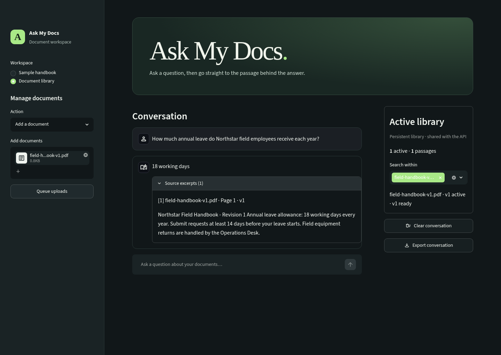

# Ask My Docs

A local **Retrieval-Augmented Generation (RAG)** service for document Q&A with a Streamlit workspace, a Flask API, and a background indexing worker. Upload a PDF, inspect the page behind an answer, then replace or delete the document and query the same library from either interface.



## How RAG works

The worker splits documents into passages and stores their Ollama embeddings in SQLite. When you ask a question, the service retrieves the most relevant passages and gives them to the chat model as context. The answer includes citations with excerpts and PDF page numbers so you can check the evidence.

## Run locally

Use Python 3.11 or 3.12.

```bash
git clone https://github.com/pspcps/ask-my-docs.git
cd ask-my-docs
python -m venv .venv
source .venv/bin/activate
python -m pip install -r requirements.txt
python -m streamlit run app.py
```

On Windows PowerShell, activate with `.venv\Scripts\Activate.ps1`. Visit <http://127.0.0.1:8501>. The **Sample handbook** is a standalone preview with preset answers and keyword search. To use the persistent library, install [Ollama](https://ollama.com/download), start it if needed, and pull the models.

```bash
ollama pull nomic-embed-text
ollama pull llama3.2
```

In two more terminals, activate the same Python environment and start the worker and API.

```bash
python worker.py  # Processes queued jobs
python api.py     # Run separately. API listens on 127.0.0.1:8000
```

Streamlit uses the same Python service as the API. The API process is optional for UI-only use. The worker must run for queued jobs to finish.

## Demo the PDF lifecycle

1. Select **Document library** and upload [field-handbook-v1.pdf](examples/field-handbook-v1.pdf). Queue the upload and wait until version 1 is ready.
2. Ask **“How much annual leave do Northstar field employees receive each year?”** Open **Source excerpts** to see **18 working days** on page 1 and confirm the cited version.
3. In **Manage documents**, select the existing handbook and upload [field-handbook-v2.pdf](examples/field-handbook-v2.pdf) as its replacement. Version 1 remains available until version 2 publishes. Ask again and check that the answer and excerpt now say **22 working days**.
4. Select the document and confirm deletion. The library no longer lists its passages. The API returns an empty retrieval result and an abstention for the same question.

The same flow can cross interfaces. Upload in Streamlit, then use the API to inspect the document and ask the same question.

```bash
curl -sS http://127.0.0.1:8000/documents
curl -sS http://127.0.0.1:8000/ask \
  -H 'Content-Type: application/json' \
  -d '{"question":"How much annual leave do Northstar field employees receive each year?"}'
```

Each answer contains `answer`, `abstained`, `reason`, `citations`, and retrieval and generation timings in milliseconds. Citations include a document ID, name, version, chunk ID, page when applicable, and excerpt. The service resolves model-selected citation numbers against retrieved chunks and abstains on missing or invalid references. Valid references alone do not guarantee that every claim is supported.

## API

| Method and route | Behavior |
| --- | --- |
| `GET /health` | Service liveness |
| `GET /documents` | Documents, active version and chunk IDs, latest job status |
| `POST /documents` | Upload multipart `file`. Returns 202 for a new job or 200 for matching active or queued content |
| `PUT /documents/<id>` | Queue a replacement under the same document ID |
| `DELETE /documents/<id>` | Remove the document, jobs and chunks. Returns 204 |
| `POST /documents/<id>/rebuild` | Re-index stored active bytes as a new version |
| `GET /jobs/<id>` | Job state, progress, attempt count and failure details |
| `POST /jobs/<id>/retry` | Requeue the latest failed job for the document |
| `POST /retrieve` | Ranked passages without answer generation |
| `POST /ask` | Answer with structured citations or abstention |

Both query endpoints accept `question`, optional `document_ids`, and optional `limit` (default 4). Omit `document_ids` to search all active documents. Send an empty list to search none. Answer generation uses up to six retrieved passages above the score threshold.

## Storage and operations

- **One store.** SQLite in WAL mode holds source bytes, SHA-256 hashes, versions, job state, and normalized vectors. The main app uses exact cosine search with NumPy, sized for a local library. No Redis or Chroma server is needed.
- **Atomic publication.** The worker claims durable jobs from SQLite and tracks progress across parsing and embedding. A successful transaction publishes the new version and removes superseded chunks. A failure leaves the last ready version searchable. If a worker stops mid-job, a running worker marks its expired lease failed after five minutes. Retry from the UI or API.
- **Embedding compatibility.** Each index version records the embedding model name, digest and index-format revision. If the model or format changes, rebuild every affected active document via **Rebuild embeddings** or the rebuild endpoint. Until rebuilt, queries scoped to those documents return a conflict. Changing only the chat model requires no rebuild.
- **Local data.** Every process must use the same absolute database path. Keep the database on local storage and personal files out of Git. The default directory, SQLite artifacts and `documents/` are ignored. Re-upload originals to migrate from the old Chroma or Redis prototype. The API is designed for a trusted local machine and has no authentication. A remote `OLLAMA_HOST` receives document text and questions.
- **Supported files.** Text PDFs, UTF-8 TXT/Markdown, DOCX and CSV. Uploads are capped at 20 MB each. Run OCR before uploading image-only PDFs.

| Variable | Default | Purpose |
| --- | --- | --- |
| `ASK_DOCS_DB` | `.ask-my-docs/library.sqlite3` under the repository | Shared SQLite path |
| `OLLAMA_HOST` | `http://127.0.0.1:11434` | Ollama server |
| `ASK_DOCS_EMBED_MODEL` | `nomic-embed-text` | Dedicated passage and question embedding model |
| `ASK_DOCS_CHAT_MODEL` | `llama3.2` | Answer model |
| `ASK_DOCS_MIN_SCORE` | `0.35` | Minimum cosine score for a passage to be passed to the answer model |

## Tests and evaluation

```bash
python -m unittest -v
python evaluate.py --hardware-note "CPU/GPU and memory of the Ollama host" --output evaluation-v1.json
```

CI runs the unit and API integration tests on Python 3.11 and 3.12 with a deterministic test engine. They cover the PDF lifecycle, duplicate detection, failed updates, retry, model change, and deletion during indexing.

The [v1 evaluation set](evaluations/v1.json) pairs answerable questions with known source passages and includes both unrelated and plausible but unsupported questions. The evaluator builds an isolated index and reports retrieval recall at *k*, citation support and precision, expected answer facts, and correct and false abstention rates. Citation and fact checks match human-labeled excerpts and terms. Inspect the per-question answers for claim-level quality. The report records median and p95 latency, corpus hashes, model digests, Ollama version, and hardware.

The [recorded CPU baseline](evaluations/baseline-v1.json) used `llama3.2` and `nomic-embed-text` on eight questions over five indexed passages. It found all six labeled passages in the top two results and abstained on all three unanswerable questions. Four of five answerable cases cited all expected sources, and three of five matched all expected facts. One answer omitted its units and another answered only half of a two-part question. Median end-to-end latency was 14.1 seconds on that CPU run.
